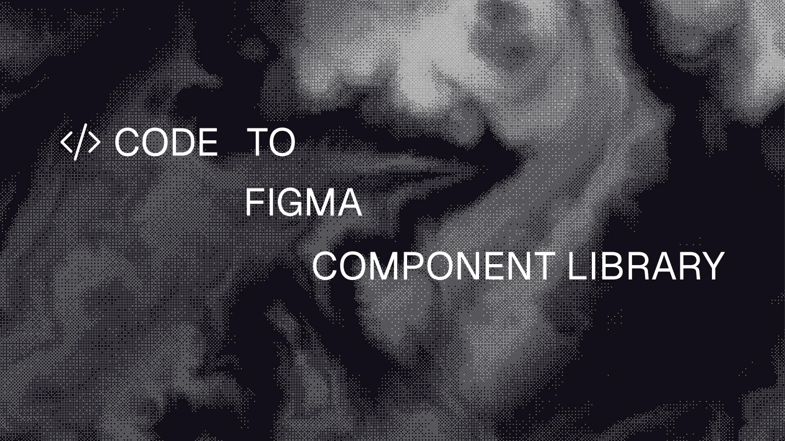
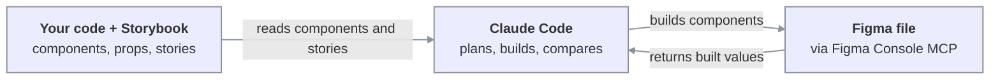

# Code to Figma Library



**Your code is the source of truth. Figma is a copy.**

This project copies your component library from code into Figma. Claude Code reads your components and Storybook, then builds matching components in an open Figma file. When the two differ, Figma is wrong and gets fixed.

## How It Works



1. **Plan.** Claude reads a component and proposes how it maps to Figma.
2. **Approve.** You review the plan and answer any questions.
3. **Build.** Claude builds the component in Figma, one at a time.
4. **Compare.** Claude checks the Figma component against Storybook.
5. **Report.** Claude writes down anything that did not carry over.

## What You Need

- [Claude Code](https://code.claude.com/docs/en/overview)
- [Storybook](https://storybook.js.org/) running locally (default `http://localhost:6006`)
- The Figma desktop app
- [Figma Console MCP](https://github.com/southleft/figma-console-mcp), connected to Claude Code (see Connect to Figma Console MCP)
- A headless browser (Playwright), installed with your approval during setup, for reading Storybook
- A Figma file open and connected (use an empty or test file, never a live library)
- The repo's package manager. Check the lockfile and use that one only

## Connect to Figma Console MCP

Do this once. It needs the Figma desktop app, not the web version.

1. **Make a Figma access token.** In Figma, open your account menu, then Settings, then Security, then Personal access tokens, then Generate new token. Copy it. Keep it private and never commit it. See the [setup guide](https://github.com/southleft/figma-console-mcp/blob/main/docs/setup.md) for which permissions to give it.
2. **Add the server to Claude Code.** Run this in your terminal with your token:

   ```
   claude mcp add figma-console -s user -e FIGMA_ACCESS_TOKEN=YOUR_TOKEN -- npx -y figma-console-mcp@latest
   ```

3. **Install the Figma plugin.** Run `npx figma-console-mcp --print-path` to print the path to the plugin. In Figma, go to Plugins, then Development, then Import plugin from manifest, and pick the `manifest.json` file at that path.
4. **Restart Claude Code.**
5. **Run the plugin in your Figma file.** Go to Plugins, then Development, then Figma Desktop Bridge. It should show `Local · ready`.
6. **Check it works.** Ask Claude: "Check Figma status". It should report a connected file.

Use an empty or test file, never a live library.

If the check fails, make sure the plugin is running in the open file, then try again. The setup guide has a troubleshooting table.

## Before You Build Components

Components bind to tokens, so the tokens must exist in Figma first. Do this once per Figma file.

1. Ask Claude to find where your tokens live (JSON, CSS custom properties, Tailwind config, or a theme file).
2. Mirror them into an empty Figma file using the prompt in
   `.claude/skills/figma-component-generator/references/tokens-setup.md`.
3. Check the result in Figma against your Storybook.

`/figma-components` stops if the file has no variables or text styles.

The first run also asks two setup questions: how your components' props map to Figma properties, and how component sets are laid out on the canvas. Your answers are saved and reused for every component.

Before the first build, Claude also sets up two scripts with you: one that reads Storybook and one that compares it to Figma. Each is written test first and checked on one real component. This needs a headless browser, which Claude installs only after you approve. Planning with `--plan-only` skips this.

## Quick Start

1. Fill in the Config block in `.claude/skills/figma-component-generator/SKILL.md` (components path, tokens path, typography path and Storybook URL).
2. Start Storybook (use the Storybook script in the component repo). Confirm it opens at the Storybook URL.
3. Open your Figma file in the desktop app and run the Figma Desktop Bridge plugin (see Connect to Figma Console MCP).
4. Start Claude Code in this folder.
5. Run the command with the components you want:

```
/figma-components Avatar Badge Button
```

To plan only, without building anything in Figma:

```
/figma-components Avatar Badge Button --plan-only
```

Claude stops and asks you before every build.

## Build Order

Always in this order. Do not skip ahead.

1. Tokens (colors, spacing, radius, sizes, opacity)
2. Text styles
3. Two test components: one simple and one that is more complicated
4. The full library

Steps 1 and 2 are done once, in "Before You Build Components" above.

## Rules

- **Code wins.** Claude never changes code to match Figma.
- **Same names on both sides.** Components, properties, values and tokens are spelled exactly as in code.
- **No guessing.** If the code does not say it, Claude writes it down instead of making it up.
- **One build at a time.** Plans run in parallel, but builds run one at a time in a queue, because they all edit the same Figma file through one connection and parallel builds could overwrite each other.
- **Nothing is deleted and recreated.** Variants are renamed and repaired so existing instances stay connected.
- **Storybook is read only.** Claude never edits stories or code, and never installs anything without asking.

## What You Get

For each component, a folder in `.claude/components/<name>/`:

| File      | When it is written | What it holds                                           |
| --------- | ------------------ | ------------------------------------------------------- |
| `PLAN.md` | Before the build   | Properties, variant count, open questions               |
| `GAPS.md` | After the build    | What did not carry over, what was unsure, what to check |

Read `GAPS.md` after every build. It is the honest list of where Figma and code differ.

Claude rewrites these files on every build. Keep your own notes somewhere else.

## Project Structure

```
├── .claude/
│   ├── CLAUDE.md        # Project rules
│   ├── agents/          # component-planner (read only), component-builder (writes to Figma)
│   ├── commands/        # /figma-components, /prime
│   ├── components/      # PLAN.md and GAPS.md for each component
│   └── skills/
│       └── figma-component-generator/
│           ├── SKILL.md      # Rules and Config
│           ├── references/   # Setup files and guides
│           ├── scripts/      # Read Storybook, compare to Figma
│           └── templates/    # GAPS.md template
└── README.md
```

## Learn More

- [Claude Code](https://code.claude.com/docs/en/overview)
- [Storybook docs](https://storybook.js.org/docs)
- [Figma Console MCP](https://github.com/southleft/figma-console-mcp)
